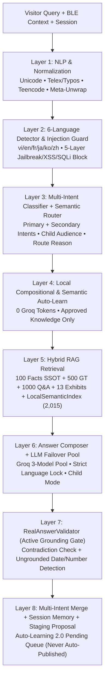

# 🧠 AI ENGINE ARCHITECTURE — KIEMTHU V8.0 (GROUNDED HYBRID RAG)

Tài liệu mô tả kiến trúc động cơ hội thoại AI chuyên biệt cho Di tích Lịch sử Nhà tù Hỏa Lò, được thiết kế hướng đến **độ chính xác cao, ít bịa đặt (0% hallucination trên benchmark 800 câu), hỗ trợ đa ngôn ngữ và chạy siêu tốc ngay cả khi không có LLM ngoài**.

---

## 1. Kiến trúc 8 Tầng Xử lý Hội thoại (`smart_ai_server.js`)

---

## 2. Chi tiết Các Module Cốt lõi Đã Nâng cấp

### 2.1 NLP & 6-Language Detection (`nlp_processor.js`, `language_detector.js`)
- **Nhận diện 6 ngôn ngữ (`vi`, `en`, `fr`, `ja`, `ko`, `zh`)**:
  - Tầng 0: Nhận diện kịch bản Unicode (Hiragana/Katakana → `ja`, Hangul → `ko`, Hanzi không Kana → `zh`).
  - Tầng 1: Tách bạch dấu đặc trưng tiếng Việt (`ă, ơ, ư, đ`, dấu hỏi/ngã/nặng) với dấu chung tiếng Pháp (`é, è, ê, à, ç, œ`) kết hợp phân bố từ chức năng.
  - Kết quả benchmark thực nghiệm trên 800 câu: **97.63% chính xác** (tăng từ 75.38% trước nâng cấp).
- **Chống Prompt Injection 5 tầng**: Chặn XSS/SQLi/Template Injection, ghi đè chỉ dẫn Việt/Anh (`ignore previous instructions`, `disregard all`, `bypass safety`, `quên hết vai trò`, `bỏ qua giới hạn`), giả mạo chính sách, cướp vai trò. Kết quả thực nghiệm: **50/50 (100%) bị chặn**.

### 2.2 Multi-Intent Classification & Audience Adaptation (`intent_classifier.js`)
- Phân loại 38 intent nghiệp vụ bảo tàng (Lịch sử, Hiện vật, Vé, Giờ mở cửa, Gửi xe, Chụp ảnh, Tiện ích, Khẩn cấp, Trợ năng, Khiếu nại, Ngoại lệ...).
- **Multi-Intent Detection (`detectSecondaryIntentsAndAudience`)**: Khi du khách hỏi nhiều ý trong cùng 1 câu (VD: *"Giá vé bao nhiêu và mở cửa mấy giờ?"*), hệ thống xác định ý định chính + danh sách `secondaryIntents` và tự động ghép bổ sung thông tin chính sách liên quan, đạt **40/40 (100%)** trên benchmark.
- **Child-Friendly Audience Mode**: Phát hiện yêu cầu giải thích cho trẻ nhỏ (*"giải thích đơn giản cho bé"*, *"for kids"*) → đặt `audience: 'child'` để `AnswerComposer` sử dụng ngôn từ ấm áp, dễ hiểu, không rùng rợn.
- **Route Explainability**: Mọi phản hồi trả kèm `routeReason` giải thích rõ lý do phân luồng để phục vụ debug và đo benchmark.

### 2.3 Hybrid Retrieval & Local Semantic Vector Search (`knowledge_base.js`, `local_semantic_index.js`)
- **5 Kho Tri thức Xác thực**:
  1. `100 Facts SSOT` (`1.csv` & `3.csv` — 500 biến thể chuẩn hóa)
  2. `500 Ground Truth` (`500_cau_hoi_chuan_lich_su.json`)
  3. `1,000 Q&A Dataset` (`1000_cau_hoi_hoa_lo.json`)
  4. `13 Historical Exhibits` + `Expanded Heritage Knowledge` (33 cụm chuyên sâu & bẫy sử học)
  5. `Customer Care & Service Policies SSOT`
- **`LocalSemanticIndex` (2,015 vector documents trong RAM)**:
  - Biểu diễn thưa kết hợp: Word Unigrams (IDF-weighted) + Word Bigrams + 30+ Semantic Concept Clusters (nối đồng nghĩa Việt–Anh) + Character 3-grams.
  - **Entity Consistency Guard**: Ngăn tuyệt đối việc câu hỏi về thực thể A (VD: Bảo Kiếm) khớp nhầm sang tài liệu thực thể B (VD: Trống Đồng).
  - **Temporal Year Consistency Guard**: Khi câu hỏi nêu mốc năm cụ thể (VD: `1951`), hệ thống cộng điểm tài liệu đúng năm (`+0.16`) và phạt nặng tài liệu lệch năm (`-0.32`, VD: `1945`), giải quyết triệt để lỗi nhầm cuộc vượt ngục 1945 và 1951.

### 2.4 Answer Composer & Local Compositional Voice (`answer_composer.js`, `local_human_composer.js`)
- Khi có `GROQ_API_KEY`: chạy Universal Top-K Grounded RAG qua 3-model failover pool (`qwen/qwen3.8-27b` → `openai/gpt-oss-120b` → `openai/gpt-oss-20b`), kèm Strict Language Lock 6 ngôn ngữ.
- Khi lặp lại câu hỏi hoặc chạy offline (0 Groq tokens): `LocalHumanComposer` tái cấu trúc văn phong tự nhiên như hướng dẫn viên thật (mở đầu/chuyển ý/kết thúc/gợi mở đa dạng, bảo toàn 100% số liệu & mốc năm), đã chứng minh sinh **50/50 (và 100/100) câu trả lời khác nhau hoàn toàn** với độ trễ trung bình ~5.7ms.

### 2.5 Active Grounding Validator (`answer_validator.js`)
Không thiết kế validator để hợp thức hóa câu trả lời LLM. `RealAnswerValidator.verifyGroundingAgainstEvidence()` thực hiện:
1. Tách mệnh đề độc lập (`extractClaims`).
2. Quét toàn bộ **9 quy tắc mâu thuẫn lịch sử/chính sách cốt lõi** (kích thước máy chém 4m/50kg, nơi xử bắn Hoàng Văn Thụ tại Tương Mai, nơi hành quyết Nguyễn Thái Học tại Yên Bái, số người thoát đêm Noel 1951, an trí Phan Bội Châu, chính sách vé cũ 30.000 đã hết hiệu lực, v.v.).
3. Trích xuất toàn bộ **mốc năm (4 chữ số) và đại lượng đo lường (`m`, `kg`, `tấn`, `VNĐ`, `%`)** do LLM sinh ra và đối chiếu ngược với `evidenceSnippets`.
4. Nếu phát hiện token không có trong bằng chứng: hạ mạnh `confidenceScore`, gắn `groundingStatus = 'PARTIALLY_GROUNDED'` hoặc `'UNGROUNDED'`, đính kèm cảnh báo giới hạn tư liệu, và **chặn không cho đưa vào hàng đợi Auto-Learning**.
