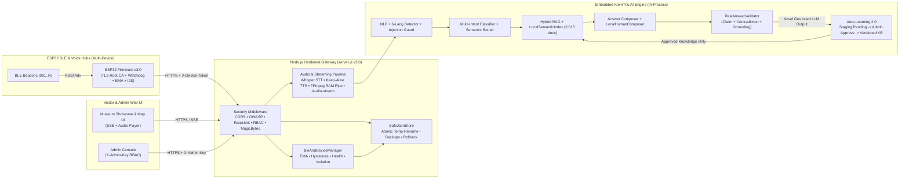

# 🏛️ SYSTEM ARCHITECTURE — SMART MUSEUM GUIDE V3.0 (22-11)

Tài liệu mô tả kiến trúc hệ thống **Smart Museum Guide** sau quá trình tái cấu trúc và nâng cấp toàn diện từ bản v2.3 lên **v3.0 Hardened Production Gateway**.

---

## 1. So sánh Kiến trúc Cũ (v2.3) vs Kiến trúc Mới (v3.0)

| Thành phần | Kiến trúc Cũ (v2.3) | Kiến trúc Mới (v3.0) |
| :--- | :--- | :--- |
| **HTTP Gateway & Security** | Wildcard CORS `*`, Admin API fail-open khi thiếu key, không Rate Limit, không kiểm tra magic bytes âm thanh, lộ stack trace | Hardened Gateway (`src/security/security_middleware.js`): Strict `ALLOWED_ORIGINS`, OWASP headers, 4-tier sliding-window Rate Limiter, fail-closed Admin RBAC (`503/401`), `DeviceAuthManager` SHA-256 tokens, magic-byte audio check (`415`), payload limits (`413`), zero stack leak |
| **Storage & Persistence** | `fs.writeFileSync` trực tiếp vào `beacons.json` & `auto_learned_knowledge.json` (nguy cơ hỏng file khi crash) | `SafeJsonStore` (`src/storage/safe_store.js`): Atomic write (`temp → rename`), rolling backups `data/backups/`, auto-recovery khi JSON hỏng, rollback API, structured secret-redacting logger |
| **BLE & Multi-Device IoT** | 1 global `latestBeacon`, cooldown đơn giản, không có EMA/hysteresis/heartbeat, ESP32 dùng `setInsecure()` | `BleAndDeviceManager` (`src/iot/ble_manager.js`): per-device state isolation, EMA RSSI smoothing, `+6 dBm` hysteresis, 2-hit stability, smart cooldown, duplicate MAC/code conflict guard, calibration API, heartbeat & `ONLINE/DEGRADED/OFFLINE` health; ESP32 v3.0 bỏ `setInsecure()` ở Production (ISRG Root X1 CA), Watchdog 15s, Wi-Fi backoff, I2S mic capture & barge-in |
| **AI Engine & Grounding** | Validator chỉ chạy cục bộ trong một số nhánh; 1-intent routing; không có chế độ trẻ em; thiếu detector JA/KO/ZH | Multi-intent + Child audience mode (`intent_classifier.js`), 6-language statistical + Unicode script detector (`language_detector.js`), Hybrid RAG + `LocalSemanticIndex` (2,015 vector docs + year-consistency guard), `LocalHumanComposer` (0 Groq tokens), `RealAnswerValidator.verifyGroundingAgainstEvidence()` bắt buộc trên mọi LLM output |
| **Auto-Learning** | Tự động ghi câu trả lời LLM vào KB và phục vụ ngay lập tức (rủi ro tích lũy hallucination) | **Auto-Learning 2.0**: Tách cứng **Staging (`pending`)** và **Production (`approved`)**, kiểm tra Prompt Injection + Contradiction trước khi vào staging, bắt buộc Admin duyệt, lưu provenance + version snapshots + rollback |
| **Audio Streaming** | Nhiều chunk WAV rời rạc gây khựng giữa câu, không có retry TTS | Single Progressive Streaming `.WAV` (`/audio-stream/:id.wav`) nối PCM liền mạch 0ms + RAM PCM cache + bounded TTS retry + per-device `voice_seq` superseding guard |
| **QA & CI/CD** | Không có test tự động, không có benchmark độc lập, không có CI pipeline | `npm test` (30-file syntax check + 9 unit + 6 security + 5 integration tests), `npm run benchmark` (800-case multilingual hold-out + 1/10/50/100 load test), `.github/workflows/ci.yml` |

---

## 2. Sơ đồ Kiến trúc Tổng thể (v3.0)

---

## 3. Cấu trúc Module Chính

| Đường dẫn | Trách nhiệm |
| :--- | :--- |
| `server.js` | HTTP/SSE Gateway, Audio Streaming Pipeline, API routing, lifecycle management |
| `src/security/security_middleware.js` | CORS, OWASP headers, sliding-window Rate Limiter, Admin fail-closed auth, Device SHA-256 token RBAC, audio magic-byte validation, input sanitization |
| `src/storage/safe_store.js` | Atomic JSON persistence (`temp → rename`), rolling backups, corruption auto-recovery, rollback, structured secret-redacting logging |
| `src/iot/ble_manager.js` | Multi-device BLE RSSI EMA smoothing, hysteresis, stability count, cooldown, duplicate conflict detection, environment calibration, heartbeat & health telemetry |
| `kiemthu/smart_ai_server.js` | Core AI orchestrator (NLP → Intent → Semantic Router → RAG → Composer → Validator → Auto-Learning 2.0) |
| `kiemthu/engine/nlp_processor.js` | Unicode normalization, typo correction, prompt injection / XSS / SQLi guard |
| `kiemthu/engine/language_detector.js` | 6-language detector (`vi/en/fr/ja/ko/zh`) using Unicode script + morphological statistics |
| `kiemthu/engine/intent_classifier.js` | Primary intent + `secondaryIntents` (multi-intent) + `audience` (`child`/`general`) + `routeReason` |
| `kiemthu/engine/semantic_router.js` | 5-zone semantic domain gate (Emergency, Site Operations, Noise, Empathy, Out-of-Domain) |
| `kiemthu/engine/knowledge_base.js` | Hybrid KB (100 Facts SSOT, 500 Ground Truth, 1,000 Q&A, 13 Exhibits, Service Policies, Year-Consistent IDF Retriever) |
| `kiemthu/engine/local_semantic_index.js` | Pure-JS sparse semantic vector search (2,015 docs, 30+ concept clusters, bigrams, char 3-grams, entity & year consistency guards) |
| `kiemthu/engine/answer_composer.js` | Grounded answer composition, child-friendly tone, multilingual synthesis |
| `kiemthu/engine/local_human_composer.js` | Compositional natural voice variation engine (0 Groq tokens on repeated queries) |
| `kiemthu/engine/answer_validator.js` | `RealAnswerValidator`: atomic claim check, historical contradiction rules, ungrounded number/date detection |
| `kiemthu/engine/auto_learning_store.js` | Auto-Learning 2.0 with Staging/Approved separation, provenance, versioning, rollback, visitor feedback |
| `esp32_firmware/esp32_ble_dialogue.ino` | ESP32 Firmware v3.0 (TLS ISRG Root X1 CA, 15s Task Watchdog, Wi-Fi backoff, I2S INMP441 mic, barge-in, heartbeat) |

---

## 4. Luồng Xử lý Chính (Request Flows)

### 4.1 Luồng BLE Beacon Trigger
1. ESP32 quét BLE quảng bá → lọc EMA + hysteresis trên thiết bị → gửi `POST /api/ble-scan` kèm `X-Device-Token`.
2. Gateway xác thực Rate Limit (`ble` tier) & Device Token → `BleAndDeviceManager.processScan()` tính EMA, kiểm tra hysteresis (`+6 dBm`), số mẫu ổn định (`>= 2`), cooldown và định vị trung thực (`PROXIMITY_IMMEDIATE` / `ZONE_NEAR` / `ROOM_FAR`).
3. Nếu `TRIGGER`: trả về URL file `.wav` đa ngôn ngữ được cache sẵn theo ngôn ngữ riêng của thiết bị + phát sự kiện SSE cho UI.

### 4.2 Luồng Hỏi Đáp Giọng Nói (Voice Ask)
1. ESP32 ghi âm I2S WAV (hoặc UI gửi text/WAV) tới `POST /api/hub/ask` kèm `device_id`, `voice_seq`, `language`.
2. Gateway kiểm tra `MAX_AUDIO_BYTES <= 5MB` + `validateAudioBufferMagic()` (từ chối file giả mạo bằng `415`).
3. Nếu là audio: Whisper STT (có RMS Silence Guard chống gửi file im lặng) chuyển sang văn bản.
4. AI Engine xử lý 8 tầng (NLP → Injection Guard → Multi-Intent/Audience → Hybrid RAG/LocalSemanticIndex → Composer → `RealAnswerValidator.verifyGroundingAgainstEvidence()` → Staging proposal nếu là tri thức LLM mới).
5. TTS Pipeline chia câu `<= 148 ký tự`, gọi Google TTS Keep-Alive có retry giới hạn, giải mã PCM trong RAM qua FFmpeg pipe, phát ngay **Single Progressive Streaming `.WAV`** (`/audio-stream/:id.wav`) từ đoạn 1 trong khi nối đoạn 2..N không ngắt quãng.
