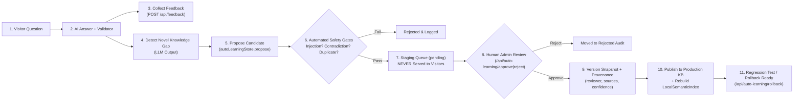

# 🔄 AUTO-LEARNING 2.0 ARCHITECTURE — PROVENANCE, APPROVAL & ROLLBACK

Tài liệu thiết kế kiến trúc **Auto-Learning 2.0** (`kiemthu/engine/auto_learning_store.js`) nhằm giải quyết triệt để rủi ro đầu độc tri thức (knowledge poisoning) và tích lũy thông tin sai lệch từ LLM.

---

## 1. Vấn đề của Cơ chế Tự học Cũ (v1)

Ở phiên bản cũ, mỗi khi Groq LLM trả lời một câu hỏi mới, hệ thống tự động ghi thẳng câu trả lời đó vào `auto_learned_knowledge.json` và phục vụ trực tiếp cho các khách tham quan sau. Hệ quả:
- **Hallucination Persistence**: Một lần LLM bịa đặt sẽ trở thành "sự thật vĩnh viễn" trong bộ nhớ cục bộ.
- **Prompt Injection Persistence**: Kẻ tấn công có thể cố tình hỏi câu dẫn dụ để đầu độc kho tri thức chung.
- **Không có Rollback & Provenance**: Không biết tri thức đến từ nguồn nào, ai phê duyệt, và không thể khôi phục khi phát hiện sai.

---

## 2. Quy trình Auto-Learning 2.0 (11 Bước Khép kín)



---

## 3. Các Cơ chế Bảo vệ Bắt buộc

### 3.1 Tách biệt Tuyệt đối Staging (`pending`) vs Production (`approved`)
- `LocalSemanticIndex` của Auto-Learning **CHỈ lập chỉ mục các bản ghi trong mảng `approved`**.
- Mọi đề xuất mới từ `propose()` nằm cô lập trong `pending` với `status: 'PENDING_REVIEW'`.
- Kiểm thử `Unit 5` và `Integration 4` chứng minh: câu hỏi mới sau khi `propose()` **trả về `null`** khi tìm kiếm ngữ nghĩa; chỉ sau khi Admin gọi `POST /api/auto-learning/approve` với `X-Admin-Key` hợp lệ thì mới bắt đầu được phục vụ.

### 3.2 Cổng Kiểm duyệt Tự động trước Staging
Trước khi một đề xuất được phép vào `pending`:
1. **Prompt Injection Gate**: Gọi `nlp.detectPromptInjection(question)` và `nlp.detectPromptInjection(answer)` — từ chối ngay (`INJECTION_BLOCKED`).
2. **Contradiction Gate**: Chạy `RealAnswerValidator.verifyGroundingAgainstEvidence()` kiểm tra mâu thuẫn sử học/chính sách — từ chối ngay (`CONTRADICTION_DETECTED`).
3. **Grounding Gate**: Từ chối nếu `groundingStatus === 'UNGROUNDED'` hoặc `confidenceScore < 0.65`.
4. **Deduplication Gate**: Nếu trùng câu hỏi chuẩn hóa hoặc tương đồng ngữ nghĩa `>= 0.88` với tri thức đã có, hệ thống tự động gộp vào danh sách `aliases` thay vì tạo bản ghi trùng lặp.

### 3.3 Provenance, Versioning & Rollback
Mỗi bản ghi được phê duyệt lưu đầy đủ siêu dữ liệu:
```json
{
  "id": "AL_20261122_001",
  "question": "...",
  "aliases": ["..."],
  "answer": "...",
  "language": "vi",
  "intent": "HISTORICAL_FACT",
  "confidenceScore": 0.92,
  "groundingStatus": "GROUNDED",
  "provenance": {
    "origin": "LLM_GROUNDED_SYNTHESIS",
    "sources": ["Hồ sơ Di tích..."],
    "proposedAt": "2026-11-22T10:00:00.000Z",
    "approvedBy": "curator_hoa_lo",
    "approvedAt": "2026-11-22T10:05:00.000Z"
  },
  "version": 3
}
```
- Trước mỗi thao tác `approve()` hoặc `rollbackToVersion()`, hệ thống tự động lưu ảnh chụp vào `versions[]` (giữ tối đa 25 phiên bản) thông qua `SafeJsonStore` (atomic write + rolling backup).
- Admin có thể quay ngược về bất kỳ phiên bản nào ngay lập tức bằng `POST /api/auto-learning/rollback`, đồng thời tái lập tức `LocalSemanticIndex` để tri thức cũ ngừng phục vụ trong `< 5ms`.

### 3.4 Thu thập Phản hồi Du khách (Visitor Feedback Loop)
- Endpoint `POST /api/feedback` ghi nhận đánh giá `1..5 sao` và nhận xét của khách tham quan vào `data/visitor_feedback.json` (tối đa 500 bản ghi gần nhất).
- Các câu hỏi nhận đánh giá thấp (`rating <= 2`) được gắn cờ `needsReview: true` để Ban Quản lý Di tích bổ sung tư liệu xác thực.
